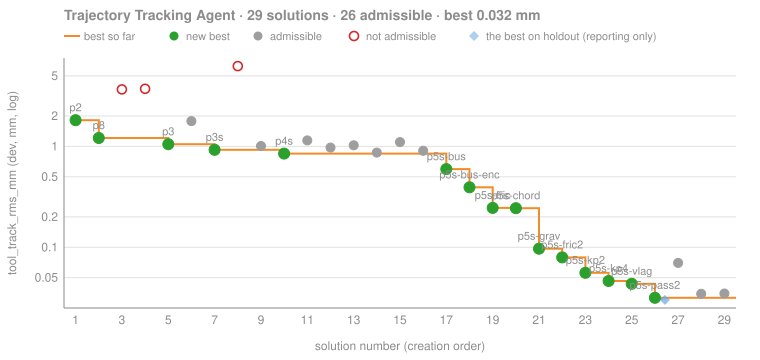

# Progress

Generated by `tta progress` from `ledger.jsonl` (ruler v1); never edit by hand.

**Best: `p5s-pass3`**, tool_track_rms_mm **0.031 mm** on dev; holdout 0.031 mm (reporting only). 31 of 34 scored solutions are admissible.

## Population

Drawn from `ledger.jsonl` only (metrics out + provenance, never a solution's code) by `tta progress`.

**Per-task winners** (dev, admissible, tasks won of 42): `p5s-pass3` 13, `p5s-kd15` 12, `p5s-pass2` 7, `p5s-onefit` 6, `p5s-kd25` 2, `p5s-vlag` 1, `p5s-kp4` 1; 7 distinct among 31 admissible. The best is weakest on ISO 9283 (median 1.09× the per-task best).

**Lineage**: each tree from a generation-0 root; colour = dev mm, thick orange = the path to the best, edge = Δ mm vs the parent.

**Gates**: dev tasks failing each gate, with the objective beside.

**Specialists**: each task's error ÷ the best admissible one; the dots are the niche winners to branch from.

## Last 10 ledger rows

| t | solution | split | objective (mm) | admissible | gate pass rate | failed gates (tasks) |
|---|---|---|---|---|---|---|
| 2026-11-24T09:45:26-07:00 | `p5s-pass3-g1-nolag` | holdout | 0.169 | yes | 100.0 % | — |
| 2026-11-24T09:45:29-07:00 | `p5s-pass3-g1` | holdout | 0.175 | yes | 100.0 % | — |
| 2026-11-24T09:45:32-07:00 | `p5s-pass3` | holdout | 0.031 | yes | 100.0 % | — |
| 2026-11-24T09:45:35-07:00 | `p5s-vlag` | holdout | 0.046 | yes | 100.0 % | — |
| 2026-11-24T09:45:39-07:00 | `p5s` | holdout | 1.139 | yes | 100.0 % | — |
| 2026-11-24T09:45:43-07:00 | `p6` | holdout | 1.190 | yes | 100.0 % | — |
| 2026-11-24T09:45:47-07:00 | `p6s` | holdout | 0.960 | yes | 100.0 % | — |
| 2026-11-24T09:45:51-07:00 | `p7` | holdout | 1.278 | yes | 100.0 % | — |
| 2026-11-24T09:45:56-07:00 | `p7s` | holdout | 0.923 | yes | 100.0 % | — |
| 2026-11-24T09:45:58-07:00 | `p8` | holdout | 1.217 | yes | 100.0 % | — |

## Gate failure matrix (dev)

Dev tasks failing each gate, from each solution's newest dev row, in creation order. 0 everywhere = admissible.

| solution | objective (mm) | `completed` | `stop_error_max_mm` | `saturation_share_pct` | `limit_violations` | `floor_clearance` |
|---|---|---|---|---|---|---|
| `p2` | 1.820 | 0 | 0 | 0 | 0 | 0 |
| `p8` | 1.212 | 0 | 0 | 0 | 0 | 0 |
| `p9` | 3.671 | 25 | 11 | 17 | 33 | 0 |
| `p10` | 3.721 | 28 | 17 | 19 | 32 | 0 |
| `p3` | 1.051 | 0 | 0 | 0 | 0 | 0 |
| `p2s` | 1.782 | 0 | 0 | 0 | 0 | 0 |
| `p3s` | 0.926 | 0 | 0 | 0 | 0 | 0 |
| `p1` | 6.250 | 41 | 41 | 0 | 0 | 0 |
| `p4` | 1.062 | 0 | 0 | 0 | 0 | 0 |
| `p4s` | 0.848 | 0 | 0 | 0 | 0 | 0 |
| `p5` | 1.077 | 0 | 0 | 0 | 0 | 0 |
| `p5s` | 0.974 | 0 | 0 | 0 | 0 | 0 |
| `p6` | 1.075 | 0 | 0 | 0 | 0 | 0 |
| `p6s` | 0.834 | 0 | 0 | 0 | 0 | 0 |
| `p7` | 1.109 | 0 | 0 | 0 | 0 | 0 |
| `p7s` | 0.887 | 0 | 0 | 0 | 0 | 0 |
| `p5s-bus` | 0.595 | 0 | 0 | 0 | 0 | 0 |
| `p5s-bus-enc` | 0.393 | 0 | 0 | 0 | 0 | 0 |
| `p5s-fric` | 0.245 | 0 | 0 | 0 | 0 | 0 |
| `p5s-chord` | 0.244 | 0 | 0 | 0 | 0 | 0 |
| `p5s-grav` | 0.097 | 0 | 0 | 0 | 0 | 0 |
| `p5s-fric2` | 0.079 | 0 | 0 | 0 | 0 | 0 |
| `p5s-kp2` | 0.056 | 0 | 0 | 0 | 0 | 0 |
| `p5s-kp4` | 0.046 | 0 | 0 | 0 | 0 | 0 |
| `p5s-vlag` | 0.043 | 0 | 0 | 0 | 0 | 0 |
| `p5s-pass2` | 0.032 | 0 | 0 | 0 | 0 | 0 |
| `p5s-fric2-pass2` | 0.070 | 0 | 0 | 0 | 0 | 0 |
| `p5s-kd15` | 0.035 | 0 | 0 | 0 | 0 | 0 |
| `p5s-kd25` | 0.035 | 0 | 0 | 0 | 0 | 0 |
| `p5s-onefit` | 0.032 | 0 | 0 | 0 | 0 | 0 |
| `p5s-pass3` | 0.031 | 0 | 0 | 0 | 0 | 0 |
| `p5s-pass3-g1` | 0.156 | 0 | 0 | 0 | 0 | 0 |
| `p5s-kp2-pass2` | 0.045 | 0 | 0 | 0 | 0 | 0 |
| `p5s-pass3-g1-nolag` | 0.141 | 0 | 0 | 0 | 0 | 0 |
