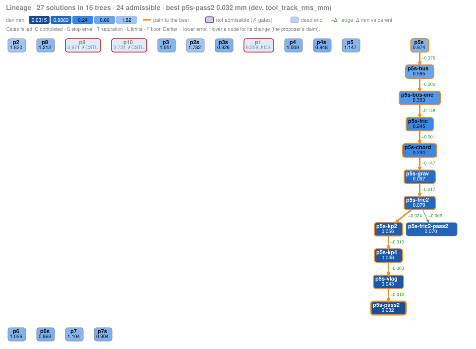

# Progress

Generated by `tta progress` from [`ledger.jsonl`](ledger.jsonl) (ruler v1).

**Best: `p5s-damping185-refit`**, tool_track_rms_mm **0.030 mm** on dev; holdout 0.031 mm (reporting only). 42 of 45 scored solutions are admissible.

## Population

Drawn from [`ledger.jsonl`](ledger.jsonl) (metrics and provenance) by `tta progress`.

**Per-task winners** (dev, admissible, tasks won of 42): `p5s-damping185-refit` 9, `p5s-accel-residual` 8, `p5s-kd15` 8, `p5s-chord-integral` 4, `p5s-pass2` 3, `p5s-damping215` 3, `p5s-inertia` 2, `p5s-friction-asym` 1, `p5s-onefit` 1, `p5s-filter-history` 1, `p5s-vlag` 1, `p5s-kp4` 1; 12 distinct among 42 admissible. The best is weakest on ISO 9283 (median 1.07× the per-task best).

**Lineage**: each tree from a generation-0 root; colour = dev mm, thick orange = the path to the best, edge = Δ mm vs the parent.

**Gates**: dev tasks failing each gate, with the objective beside.

**Specialists**: each task's error ÷ the best admissible one; the dots are the niche winners to branch from.

## Last 10 ledger rows

| t | solution | split | objective (mm) | admissible | gate pass rate | failed gates (tasks) |
|---|---|---|---|---|---|---|
| 2026-11-25T17:41:23-07:00 | `p5s-friction-asym` | dev | 0.031 | yes | 100.0 % | — |
| 2026-11-25T17:42:22-07:00 | `p5s-hold-average` | dev | 0.032 | yes | 100.0 % | — |
| 2026-11-25T17:46:16-07:00 | `p5s-accel-residual` | dev | 0.031 | yes | 100.0 % | — |
| 2026-11-25T17:46:38-07:00 | `p5s-chord-integral` | dev | 0.032 | yes | 100.0 % | — |
| 2026-11-25T17:48:40-07:00 | `p5s-damping185` | dev | 0.031 | yes | 100.0 % | — |
| 2026-11-25T17:48:58-07:00 | `p5s-damping215` | dev | 0.032 | yes | 100.0 % | — |
| 2026-11-25T17:50:08-07:00 | `p5s-filter-history` | dev | 0.032 | yes | 100.0 % | — |
| 2026-11-25T17:51:13-07:00 | `p5s-damping185-refit` | dev | 0.030 | yes | 100.0 % | — |
| 2026-11-25T17:52:47-07:00 | `p5s-task-balanced-fit` | dev | 0.031 | yes | 100.0 % | — |
| 2026-11-25T17:53:28-07:00 | `p5s-damping185-refit` | holdout | 0.031 | yes | 100.0 % | — |

## Gate failure matrix (dev)

Dev tasks failing each gate, from each solution's newest dev row, in creation order. 0 everywhere = admissible.

| solution | objective (mm) | `completed` | `stop_error_max_mm` | `saturation_share_pct` | `limit_violations` | `floor_clearance` |
|---|---|---|---|---|---|---|
| `p2` | 1.820 | 0 | 0 | 0 | 0 | 0 |
| `p8` | 1.212 | 0 | 0 | 0 | 0 | 0 |
| `p9` | 3.671 | 25 | 11 | 17 | 33 | 0 |
| `p10` | 3.721 | 28 | 17 | 19 | 32 | 0 |
| `p3` | 1.051 | 0 | 0 | 0 | 0 | 0 |
| `p2s` | 1.782 | 0 | 0 | 0 | 0 | 0 |
| `p3s` | 0.926 | 0 | 0 | 0 | 0 | 0 |
| `p1` | 6.250 | 41 | 41 | 0 | 0 | 0 |
| `p4` | 1.062 | 0 | 0 | 0 | 0 | 0 |
| `p4s` | 0.848 | 0 | 0 | 0 | 0 | 0 |
| `p5` | 1.077 | 0 | 0 | 0 | 0 | 0 |
| `p5s` | 0.974 | 0 | 0 | 0 | 0 | 0 |
| `p6` | 1.075 | 0 | 0 | 0 | 0 | 0 |
| `p6s` | 0.834 | 0 | 0 | 0 | 0 | 0 |
| `p7` | 1.109 | 0 | 0 | 0 | 0 | 0 |
| `p7s` | 0.887 | 0 | 0 | 0 | 0 | 0 |
| `p5s-bus` | 0.595 | 0 | 0 | 0 | 0 | 0 |
| `p5s-bus-enc` | 0.393 | 0 | 0 | 0 | 0 | 0 |
| `p5s-fric` | 0.245 | 0 | 0 | 0 | 0 | 0 |
| `p5s-chord` | 0.244 | 0 | 0 | 0 | 0 | 0 |
| `p5s-grav` | 0.097 | 0 | 0 | 0 | 0 | 0 |
| `p5s-fric2` | 0.079 | 0 | 0 | 0 | 0 | 0 |
| `p5s-kp2` | 0.056 | 0 | 0 | 0 | 0 | 0 |
| `p5s-kp4` | 0.046 | 0 | 0 | 0 | 0 | 0 |
| `p5s-vlag` | 0.043 | 0 | 0 | 0 | 0 | 0 |
| `p5s-pass2` | 0.032 | 0 | 0 | 0 | 0 | 0 |
| `p5s-fric2-pass2` | 0.070 | 0 | 0 | 0 | 0 | 0 |
| `p5s-kd15` | 0.035 | 0 | 0 | 0 | 0 | 0 |
| `p5s-kd25` | 0.035 | 0 | 0 | 0 | 0 | 0 |
| `p5s-onefit` | 0.032 | 0 | 0 | 0 | 0 | 0 |
| `p5s-pass3` | 0.031 | 0 | 0 | 0 | 0 | 0 |
| `p5s-pass3-g1` | 0.156 | 0 | 0 | 0 | 0 | 0 |
| `p5s-kp2-pass2` | 0.045 | 0 | 0 | 0 | 0 | 0 |
| `p5s-pass3-g1-nolag` | 0.141 | 0 | 0 | 0 | 0 | 0 |
| `p5s-inertia` | 0.032 | 0 | 0 | 0 | 0 | 0 |
| `p5s-inertia-g1` | 0.157 | 0 | 0 | 0 | 0 | 0 |
| `p5s-friction-asym` | 0.031 | 0 | 0 | 0 | 0 | 0 |
| `p5s-hold-average` | 0.032 | 0 | 0 | 0 | 0 | 0 |
| `p5s-accel-residual` | 0.031 | 0 | 0 | 0 | 0 | 0 |
| `p5s-chord-integral` | 0.032 | 0 | 0 | 0 | 0 | 0 |
| `p5s-filter-history` | 0.032 | 0 | 0 | 0 | 0 | 0 |
| `p5s-damping185` | 0.031 | 0 | 0 | 0 | 0 | 0 |
| `p5s-damping215` | 0.032 | 0 | 0 | 0 | 0 | 0 |
| `p5s-task-balanced-fit` | 0.031 | 0 | 0 | 0 | 0 | 0 |
| `p5s-damping185-refit` | 0.030 | 0 | 0 | 0 | 0 | 0 |
