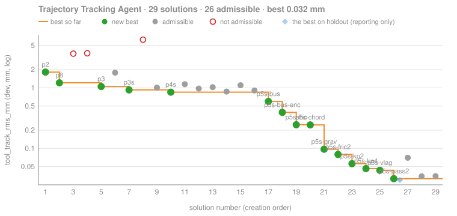

# Trajectory Tracking Agent

**[▶ Live landing page](https://zacharyyamaoka.github.io/trajectory_tracking_agent/)**, redeployed from `main` on every push · a black-box agent repo in the [blackbox_agent](https://github.com/zacharyyamaoka/blackbox_agent) format

An agent that makes robots follow a given trajectory more accurately. The trajectory and the robot are given; the
agent searches over controllers (what is fed forward, what is fed back, where each runs and how far ahead it samples)
and keeps a scored population of every solution it tried.



| File | What's in it |
|---|---|
| [`OBJECTIVES.md`](OBJECTIVES.md) | **Objectives & gates**: the black box's inputs and outputs, the deployment, the dataset, the score |
| [`AGENTS.md`](AGENTS.md) | How an agent works here: the loop and its rules |
| [`PROGRESS.md`](PROGRESS.md) | Where the search stands (generated from [`ledger.jsonl`](ledger.jsonl)) |
| [`ideas.md`](ideas.md) | The experiment queue |
| [`REFERENCES.md`](REFERENCES.md) | Prior art, the packages it builds on, related repos |
| [`solutions/`](solutions/) | The population: one folder per solution, with its lineage and scorecard |
| [`site/`](site/) | What the live page adds to blackbox_agent's stock landing and dashboard: the saved runs it plays back (scored by the ruler at evaluation time), the domain dashboards and the site bar's `nav.json` |

[Controller boundary review](reports/controller-boundary-2026-11-25.html) documents the frozen-tape checks and the UR5e replays.
[Gain transfer review](reports/gain-transfer-2026-11-25.html) compares the PD-only and inertia-augmented fits on paired UR5e runs.
[Controller search review](reports/controller-search-2026-11-25.html) covers the new leading controller, the paired trials, and the separate calibration proof.
[UR5e speed study](https://zacharyyamaoka.github.io/trajectory_tracking_agent/reports/ur5e-speed-sweep.html) links to stock Coverage, Comparison and Targets, with time at speed and the joint-limit audit. [Reproduce the study](experiments/ur5e_speed_sweep/README.md).
[UR5e conveyor baseline](reports/conveyor-baseline/index.html) replays the unchanged upright controller on a frozen 30-pick route at ten speeds. [Replay the dataset](experiments/conveyor_cycle/README.md).
[UR5e tracking goal](reports/ur5e-accuracy/index.html) reports both accuracy targets on the locked mount-aware controller, including the upright holdout and the conveyor speed sweep. [Goal evidence](goals/G1-ur5e-tracking-evidence.json).

```bash
uv run tta evaluate p7s --split dev
```

Built on [robot_msgs](https://github.com/zacharyyamaoka/robot_msgs) (the vocabulary) and
[robot_controllers](https://github.com/zacharyyamaoka/robot_controllers) (the plants, boards and controller parts).
Part of [robot-sdk](https://github.com/zacharyyamaoka/robot_sdk): packages are what agents build; agents are what
build them.
